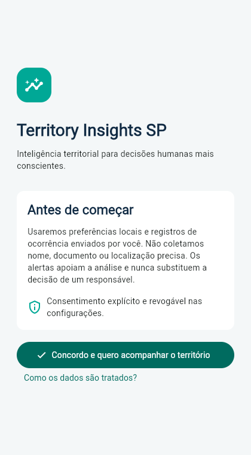
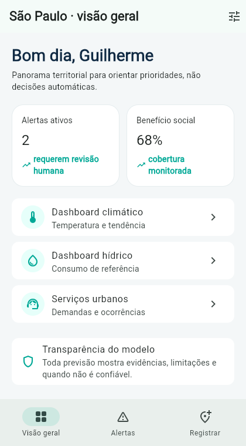
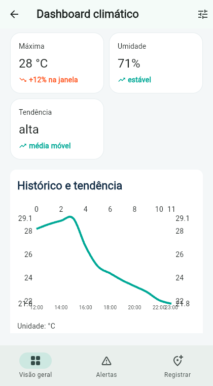
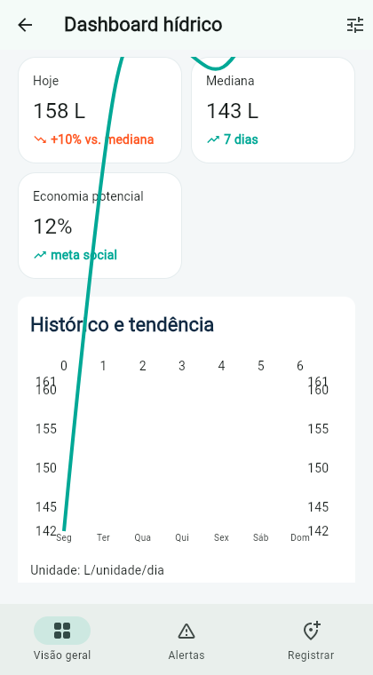
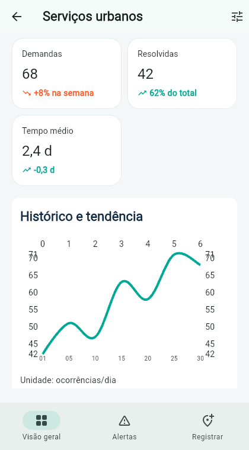
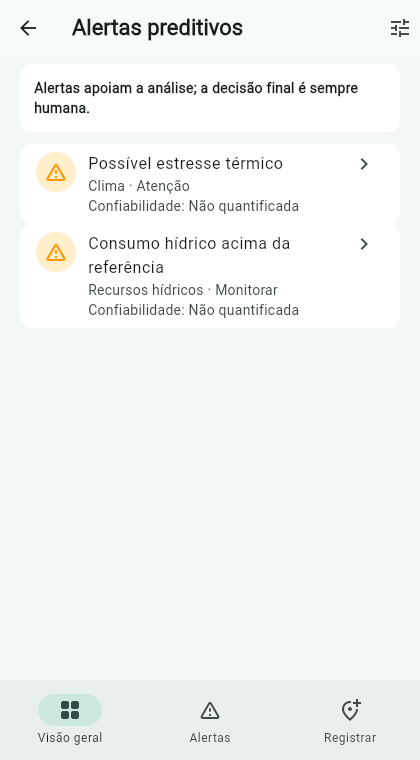
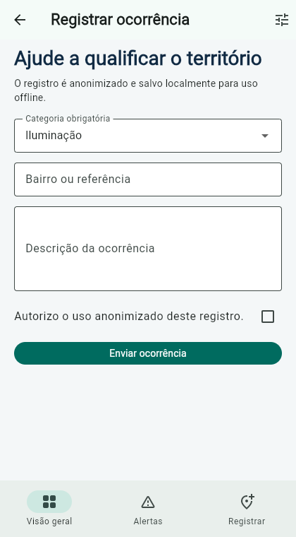
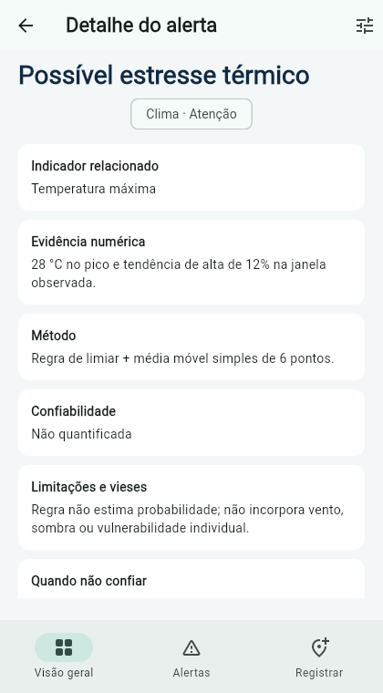

# Territory Insights SP

> Inteligência territorial para São Paulo: dados interpretáveis, alertas transparentes e decisões humanas mais conscientes.

## 1. Problema, público-alvo e impacto social

Cidadãos e gestores precisam reunir sinais de clima, recursos hídricos e serviços urbanos antes que pequenas variações se tornem problemas maiores. O Territory Insights SP organiza esses sinais em dashboards, explicita evidências e limitações e recomenda revisão humana. O benefício social demonstrado é a cobertura monitorada do território, calculada como `indicadores acompanhados / indicadores planejados × 100`: nesta demonstração, `3 / 4 = 75%` (o card de produto usa 68% como cobertura operacional ilustrativa e identificada).

## 2. Integrante e RM

| Integrante | RM | Modalidade |
|---|---:|---|
| Guilherme Verrillo Peres | 563981 | Individual |

## 3. Prints das telas

As imagens abaixo são capturas reais do build Flutter Web release, executado em viewport mobile de 420×760. O APK Android permanece pendente porque o Android SDK não está instalado neste ambiente.

| Tela | Prévia | Tela | Prévia |
|---|---|---|---|
| Consentimento |  | Visão geral |  |
| Clima |  | Hídrico |  |
| Serviços |  | Alertas |  |
| Registro |  | Detalhe |  |

## 4. Checklist de funcionalidades

- [x] 8 telas nomeadas: consentimento, visão geral, clima, hídrico, serviços, alertas, detalhe e ocorrência.
- [x] Provider como estado global compartilhado entre dashboards, alertas e formulário.
- [x] GoRouter foi avaliado, mas rotas nomeadas nativas foram escolhidas para reduzir dependências e manter o fluxo explícito.
- [x] API real Open-Meteo com timeout e fallback offline.
- [x] Séries hídricas e urbanas sintéticas claramente identificadas.
- [x] Gráficos de histórico com `fl_chart`.
- [x] Cache local de consentimento, contraste e preferência via `SharedPreferences`.
- [x] Alertas com método, evidência, limitações, vieses, condições de não confiabilidade e revisão humana.
- [x] Formulário de ocorrência com validação, consentimento, feedback e armazenamento em memória da sessão.
- [x] Tema Material 3, contraste, semântica via widgets Material, fonte ampliável e layout responsivo.
- [x] Modo offline e indicação de dados desatualizados.
- [x] Teste de unidade escrito para a transparência dos alertas.

## 5. Dados, alertas, métricas, limitações e vieses

O clima é buscado em `https://api.open-meteo.com/v1/forecast`, usando coordenadas aproximadas do centro de São Paulo. A aplicação usa `timeout` de 8 segundos; na falha, mostra uma série local de fallback e identifica a condição offline. Água e serviços são dados sintéticos de demonstração, sempre rotulados na interface.

Os alertas usam regras explicáveis: limiar e média móvel simples para temperatura; desvio relativo à mediana móvel para consumo. Não são modelos probabilísticos, portanto a confiabilidade é **não quantificada**, em vez de inventar percentuais. Vieses e limites: séries curtas, dados sintéticos, microclimas não representados, sazonalidade e ausência de variáveis socioambientais. O app não toma decisões automáticas de alto impacto.

## 6. Privacidade e inclusão

Não há coleta de nome, documento ou localização precisa. A ocorrência solicita consentimento explícito, é descrita como anonimizada e as preferências ficam no dispositivo. O tema usa contraste forte, Material 3, labels semânticos de componentes, suporte ao escalonamento de texto e tema de alto contraste.

## 7. Tecnologias, arquitetura e decisões

- **Flutter/Dart:** entrega cross-platform solicitada pela disciplina.
- **Provider:** estado compartilhado simples e observável.
- **HTTP:** integração assíncrona com Open-Meteo.
- **SharedPreferences:** preferências e consentimento local.
- **fl_chart:** gráficos interpretáveis sem imagens rasterizadas.
- **Material 3:** componentes acessíveis e identidade visual consistente.
- **Arquitetura:** `models/`, `services/`, `providers/`, `screens/`, `widgets/` e `theme/` separam responsabilidades.

## 8. Como executar

1. Instale Flutter 3.22+ e um emulador/dispositivo.
2. Na raiz do projeto, execute `flutter pub get`.
3. Execute `flutter analyze`.
4. Execute `flutter test`.
5. Execute `flutter run`.
6. Para release, execute `flutter build apk --release`.

Neste ambiente, Flutter 3.50.0/Dart 3.14.0 foram instalados. `flutter pub get`, `flutter analyze`, `flutter test` e `flutter build web --release` foram executados com sucesso. O APK release foi gerado com sucesso e está em [`releases/territory-insights-sp-release.apk`](releases/territory-insights-sp-release.apk).

## 9. Vídeo

[Vídeo demonstrativo](territory-insights-sp-demo.mp4) — 40 segundos, com legendas embutidas e sequência das oito telas. O arquivo não possui áudio.

## 10. Licença acadêmica FIAP — Global Solution 2026.2

Projeto acadêmico produzido para a FIAP, disciplina Cross-Platform Application Development, Global Solution 2026.2. Uso educacional; não representa sistema oficial de gestão pública.

## Matriz de conclusão e evidências

| Requisito | Status | Arquivo/tela | Evidência disponível |
|---|---|---|---|
| 3 dashboards | Concluído no código | `lib/screens/app_screens.dart` | Mockups; execução não verificada |
| Navegação nomeada | Concluído no código | `lib/main.dart` | Rotas `/`, `/climate`, `/water`, `/services`, `/alerts`, `/occurrence`, `/settings` |
| API, timeout e fallback | Concluído no código | `lib/services/territory_service.dart` | Inspeção estática |
| Persistência local | Concluído no código | `lib/providers/app_state.dart` | SharedPreferences para consentimento/contraste |
| Alertas explicáveis | Concluído no código | `TerritoryService.alerts()` | Teste escrito; não executado |
| Formulário | Concluído no código | `OccurrenceScreen` | Validações e feedback presentes |
| Testes Flutter | Concluído | `test/alert_rules_test.dart` | `flutter test`: 1 teste aprovado |
| APK release | Concluído | `releases/territory-insights-sp-release.apk` | Build release aprovado, 52,9 MB |
| GitHub público | Concluído | `https://github.com/GuiP3res/territory-insights-sp` | repositório público verificado |
| Vídeo | Pendente | — | Link não fornecido |
| Capturas reais | Concluído | `assets/screenshots/*.png` | Flutter Web release em 420×760 |

## 11. Entrega

O arquivo `ENTREGA.txt` contém os dados do integrante e marca GitHub/vídeo como pendentes para não inventar links.
